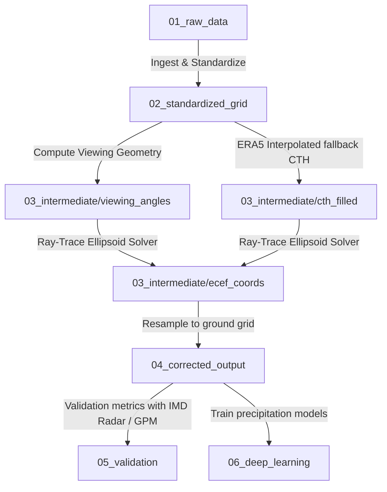

# Project Index: PyGeoParallax-IN

This index acts as a reference for the directory structure and processing pipeline of the `PyGeoParallax-IN` project. The project focuses on correcting cloud parallax errors in INSAT-3DR satellite observations over India using Cloud-Top Height (CTH) datasets, ERA5 atmospheric reanalysis, GPM-DPR satellite radar overpasses, and IMD Doppler Weather Radar (DWR) grids.

---

## Directory Hierarchy & Roles

### [00_Documentation](.)
Contains background literature, project indices, data access logs, API configurations, and reading progress.
*   **[related_papers/](related_papers)**: Core reference papers on satellite parallax shift corrections (e.g., Vicente et al. 2002, Bieliński 2020).
*   **[reading_tracker.md](related_papers/reading_tracker.md)**: Tabulated literature review tracking method details, project relevance, and study status.
*   **[data_access_notes.md](data_access_notes.md)**: Developer credentials, login steps, download scripts, and rate limits for IMD, MOSDAC, Copernicus (ERA5), and NASA EarthData.
*   **[project_tracker.md](project_tracker.md)**: Master timeline progress tracker for all 16 implementation weeks.
*   **[project_dashboard.html](project_dashboard.html)**: Interactive visual dashboard to track tasks, progress percentages, and log performance metrics (opens in web browser).

### [01_raw_data](../01_raw_data)
Raw geospatial data organized by source and time periods (June-September monsoon seasons: JJAS).
*   **[insat3dr_l1c/](../01_raw_data/insat3dr_l1c)**: INSAT-3DR Level-1C (L1C) imager data in HDF5 format.
*   **[insat3dr_cth/](../01_raw_data/insat3dr_cth)**: Cloud Top Height (CTH) products from MOSDAC.
*   **[era5_reanalysis/](../01_raw_data/era5_reanalysis)**: Temperature and geopotential height profiles for vertical interpolation.
*   **[gpm_dpr_2adpr/](../01_raw_data/gpm_dpr_2adpr)**: GPM Dual-frequency Precipitation Radar (2A.DPR) overpasses for high-res vertical validation.
*   **[imd_dwr/](../01_raw_data/imd_dwr)**: Indian Meteorological Department Doppler Weather Radar grids (Mumbai, Goa, Kochi, Agartala).
*   **[srtm_dem/](../01_raw_data/srtm_dem)**: Shuttle Radar Topography Mission (SRTM) DEM tiles for terrain-base projection.

### [02_standardized_grid](../02_standardized_grid)
Intermediate products resampled and projected onto the standard 0.04-degree grid over the South Asian domain.
*   **[insat_0p04deg/](../02_standardized_grid/insat_0p04deg)**: Resampled INSAT-3DR channels.
*   **[era5_0p04deg/](../02_standardized_grid/era5_0p04deg)**: Resampled ERA5 profiles.
*   **[srtm_0p04deg/](../02_standardized_grid/srtm_0p04deg)**: Colocated elevation model.

### [03_intermediate](../03_intermediate)
Working directories for coordinate transformations and geometry solver outputs.
*   **[viewing_angles/](../03_intermediate/viewing_angles)**: Viewing Zenit Angle (VZA), Viewing Azimuth Angle (VAA), Solar Zenith Angle (SZA) maps.
*   **[cth_filled/](../03_intermediate/cth_filled)**: Unified CTH grids with ERA5 fallback height values applied to null/noise pixels.
*   **[ecef_coords/](../03_intermediate/ecef_coords)**: Earth-Centered, Earth-Fixed (ECEF) coordinates used in the parallax ray-tracing algorithm.

### [04_corrected_output](../04_corrected_output)
Final outputs of PyGeoParallax-IN, stored in both spatial formats.
*   **[geotiff/](../04_corrected_output/geotiff)**: Projected single-channel raster products.
*   **[netcdf/](../04_corrected_output/netcdf)**: Multi-channel spatio-temporal datasets with complete metadata.

### [05_validation](../05_validation)
Analysis outputs validating the corrected observations.
*   **[gpm_colocation/](../05_validation/gpm_colocation)**: Colocation statistics between INSAT and GPM overpasses.
*   **[imd_iou_results/](../05_validation/imd_iou_results)**: Intersection over Union (IoU) spatial matching metrics with ground radars.
*   **[regional_stats/](../05_validation/regional_stats)**: Detailed tables partitioned for Ghats, Himalayas, and Central India.
*   **[monte_carlo_sensitivity/](../05_validation/monte_carlo_sensitivity)**: Sensitivity runs on CTH uncertainty.

### [06_deep_learning](../06_deep_learning)
Downstream applications evaluating the impact of parallax correction on precipitation prediction model training.
*   **[model_a_uncorrected/](../06_deep_learning/model_a_uncorrected)**: DL models trained on uncorrected INSAT L1C.
*   **[model_b_corrected/](../06_deep_learning/model_b_corrected)**: DL models trained on corrected datasets.
*   **[eval_metrics/](../06_deep_learning/eval_metrics)**: Inter-model verification plots and validation outputs.

### [07_figures](../07_figures)
Manuscript-ready charts, scatterplots, maps, and flowcharts.

### [08_manuscript](../08_manuscript)
LaTeX sources, figure lists, references, and submitted versions of the research paper.

---

## Pipeline Workflow Summary

